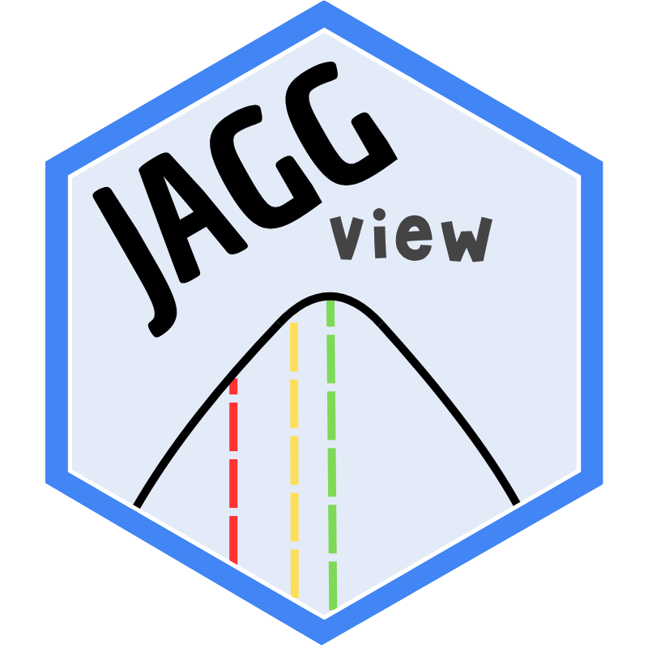
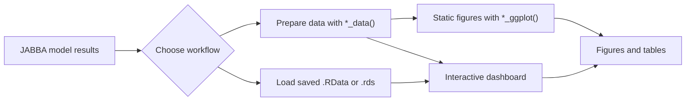

#  JAGGview

<br clear="left" />

> **An R toolkit and interactive dashboard for exploring results from [JABBA](https://github.com/jabbamodel/JABBA) stock-assessment models.**

[](https://www.r-project.org/)
[](https://shiny.posit.co/)
[](https://ggplot2.tidyverse.org/)
[](https://creativecommons.org/licenses/by-nc-sa/4.0/)

---

## Contents

- [What JAGGview does](#what-jaggview-does)
- [Workflow at a glance](#workflow-at-a-glance)
- [Installation](#installation)
- [Quick start](#quick-start)
- [Complete tutorial](#complete-tutorial)
- [Launch the interactive dashboard](#launch-the-interactive-dashboard)
- [Analysis modules](#analysis-modules)
- [Build static figures](#build-static-figures)
- [Useful extractors](#useful-extractors)
- [Input expectations](#input-expectations)
- [Testing and package checks](#testing-and-package-checks)
- [License and authors](#license-and-authors)

---

## What JAGGview does

**JAGGview** converts fitted-model and hindcast results produced by **JABBA** into structured data, static `ggplot2` visualizations, summary tables, and an interactive `shiny`/`bs4Dash` dashboard. It focuses on visualizing and interpreting model outputs; model fitting itself is performed by JABBA.

| Stage | JAGGview provides | Typical questions |
| :-- | :-- | :-- |
| **Prepare** | Standardized `*_data()` objects | Which estimates and uncertainty intervals should be visualized? |
| **Diagnose** | Fit, hindcast, residual, run-test, and retrospective views | Are there patterns or potential conflicts in model results? |
| **Interpret** | Trajectories, Kobe plots, prior/posterior comparisons, and summary tables | What do the results indicate about stock status? |
| **Communicate** | Customizable figures and an interactive dashboard | How can results be reviewed and shared? |

## Workflow at a glance



Use the preparation and plotting functions for a scripted, reproducible workflow, or use `create_report()` to explore results in the dashboard.

## Installation

### 1. Install JAGS

JABBA uses JAGS through R interfaces such as `rjags`. Install JAGS for your operating system before installing the R packages.

On Ubuntu/Debian:

```bash
sudo apt update
sudo apt install jags
```

For other operating systems, follow the [official JAGS project instructions](https://mcmc-jags.sourceforge.io/).

### 2. Install the R dependencies and packages

```r
install.packages(c("remotes", "rjags", "R2jags"))

remotes::install_github("jabbamodel/JABBA", dependencies = TRUE)
remotes::install_github("UNIVALI-LEMA/JAGGview", dependencies = TRUE)
```

To install a specific branch, append its name after `@`, for example:

```r
remotes::install_github("UNIVALI-LEMA/JAGGview@develop", dependencies = TRUE)
```

To install from a local clone of the repository:

```r
remotes::install_local(".")
```

## Quick start

The functions below expect JABBA model output already created with `JABBA::fit_jabba()`. Replace `list_fit_models` with your fitted object or list of fitted objects.

```r
library(JAGGview)

fits <- fits_data(list_fit_models)

p <- fits_ggplot(
  fits,
  palette = "#2C7FB8",
  title_y = "Abundance index"
)

print(p)
```

For hindcast output created with `JABBA::hindcast_jabba()`:

```r
hindcast <- hindcast_data(list_hc_models)
p_hindcast <- hindcast_ggplot(hindcast)
print(p_hindcast)
```

## Complete tutorial

A longer, runnable R script is provided at **[`inst/scripts/tutorial.R`](inst/scripts/tutorial.R)**. It demonstrates an end-to-end example using the `iccat` dataset included with JABBA: building and fitting example scenarios, generating hindcasts, preparing data, creating plots for the main analysis modules, extracting summary values, and launching the dashboard.

After installing JAGGview, the installed tutorial can be located with:

```r
system.file("scripts", "tutorial.R", package = "JAGGview")
```

You can open that path in RStudio/Positron and run the sections as needed. The script is intended as a user-facing example, not as an automated test; it therefore lives under `inst/scripts/` rather than `tests/`. The tutorial may take time to run because it fits example JABBA models and generates multiple plots.

## Launch the interactive dashboard

`create_report()` builds an interactive Shiny dashboard. You can either let it load saved model results or pass data objects that you have already prepared.

### Option A — Load saved results

```r
library(JAGGview)

create_report(
  filename = "model_results.RData",
  dir = "path/to/results",
  animation = TRUE,
  verbose = TRUE
)
```

The loader supports `.RData` and `.rds` inputs containing compatible JABBA fit or hindcast objects.

### Option B — Supply prepared data

```r
fits <- fits_data(list_fit_models)
hind <- hindcast_data(list_hc_models)
kobe <- kobe_data(list_fit_models)
pp <- priors_posteriors_data(list_fit_models)
ra <- retrospective_analysis_data(list_hc_models)
runs <- runs_tests_data(list_fit_models)
traj <- trajectories_data(list_fit_models)

create_report(
  fits_data = fits,
  hind_data = hind,
  kobe_data = kobe,
  pp_data = pp,
  ra_data = ra,
  res_data = runs,
  traj_data = traj,
  animation = FALSE
)
```

### Dashboard guide

| Area | What you can inspect |
| :-- | :-- |
| **Fits** | Observed abundance indices, fitted values, and 80% / 95% credibility intervals. |
| **Runs Tests** | Residual run-test diagnostics across model scenarios. |
| **CPUE Residuals** | Residual patterns, smoothed trends, and RMSE annotations. |
| **Priors × Posteriors** | Prior and posterior distributions for carrying capacity (`K`), intrinsic growth rate (`r`), and initial depletion (`psi`). |
| **Retrospective Analysis** | Biomass, fishing mortality, B/Bmsy, F/Fmsy, process error, and surplus-production peels. |
| **Hindcast** | Observed versus predicted hindcast values and MASE performance measures. |
| **Trajectories** | Biomass, harvest rate, catch, and related reference-point ratios over time. |
| **Kobe** | Stock-status trajectories relative to biomass and fishing-mortality reference points. |
| **Summary tables** | Tabular summaries of model estimates and derived indicators. |

## Analysis modules

The typical workflow is to prepare a `JAGGdata` object with a `*_data()` function and pass it to the corresponding plotting function.

| Module | Prepare data | Plot | Focus |
| :-- | :-- | :-- | :-- |
| Fitted indices | `fits_data()` | `fits_ggplot()` | Observations, fitted indices, and credibility intervals. |
| Hindcast | `hindcast_data()` | `hindcast_ggplot()` | Predictive performance and MASE. |
| Kobe | `kobe_data()` | `kobe_ggplot()` | Biomass and fishing-mortality status relative to reference points. |
| Priors vs. posteriors | `priors_posteriors_data()` | `priors_posteriors_ggplot()` | Prior and posterior distributions for model parameters. |
| Retrospective analysis | `retrospective_analysis_data()` | `retrospective_analysis_ggplot()` | Peel behavior and retrospective-bias diagnostics. |
| Runs tests | `runs_tests_data()` | `runs_tests_ggplot()` | Residual structure by scenario. |
| CPUE residuals | `runs_tests_data()` | `cpue_residuals_ggplot()` | Residual time series, trends, and RMSE. |
| Trajectories | `trajectories_data()` | `trajectories_ggplot()` | Biomass, harvest, catch, and related indicators. |

Most plotting functions return a `ggplot` object. Customize labels, palettes, axis limits, and facet layout through function arguments or additional `ggplot2` layers. Save figures with `ggplot2::ggsave()`.

## Build static figures

```r
library(JAGGview)
library(ggplot2)

trajectory_data <- trajectories_data(list_fit_models)
trajectory_plot <- trajectories_ggplot(trajectory_data)

ggsave(
  filename = "trajectory.png",
  plot = trajectory_plot,
  width = 10,
  height = 6,
  dpi = 300
)
```

## Useful extractors

These helpers can be used in analyses, tables, or reports.

| Function | Returns |
| :-- | :-- |
| `get_mase(hindcast_data)` | Hindcast MASE values by index and scenario. |
| `get_pars(list_fit_models)` | Parameter estimates from fitted models. |
| `get_ppmr(priors_posteriors_data)` | Posterior probability metric results. |
| `get_ppvr(priors_posteriors_data)` | Posterior probability variable results. |
| `get_refpts(list_fit_models)` | Reference points from fitted models. |
| `get_rho(retrospective_analysis_data)` | Retrospective-bias (`rho`) metrics. |
| `get_estimates(list_fit_models)` | Fitted estimates. |
| `get_stats(list_fit_models)` | Model summary statistics. |
| `get_hc_estimates(list_hc_models)` | Hindcast estimates. |
| `get_hc_pars(list_hc_models)` | Hindcast parameter summaries. |
| `get_hc_stats(list_hc_models)` | Hindcast summary statistics. |
| `summary_table(...)` | A formatted summary table. |

## Input expectations

- Fit-based functions accept a JABBA fitted-model object or a list of fitted objects returned by `JABBA::fit_jabba()`.
- Hindcast-based functions accept a JABBA hindcast object or a list of hindcast objects returned by `JABBA::hindcast_jabba()`.
- Lists allow comparison of multiple scenarios in a single visualization.
- Preparation functions return structured data objects for their paired plotting functions and, where supported, `create_report()`.
- When loading saved files, use `.RData` or `.rds` files containing compatible fit or hindcast results.

## Testing and package checks

Run the package tests from the repository root:

```r
devtools::test()
```

Alternatively, run testthat tests directly:

```r
testthat::test_dir("tests/testthat")
```

Before submitting package changes, it is also good practice to run:

```r
devtools::document()
devtools::check()
```

## License and authors

JAGGview is distributed under the [Creative Commons Attribution–NonCommercial–ShareAlike 4.0 International License](https://creativecommons.org/licenses/by-nc-sa/4.0/).

**Authors:** Thiago Yukio Horita Pacheco and Rodrigo Sant'Ana.

---

<p align="center">
  Built to make <strong>JABBA</strong> model results easier to inspect, explain, and share.
</p>
